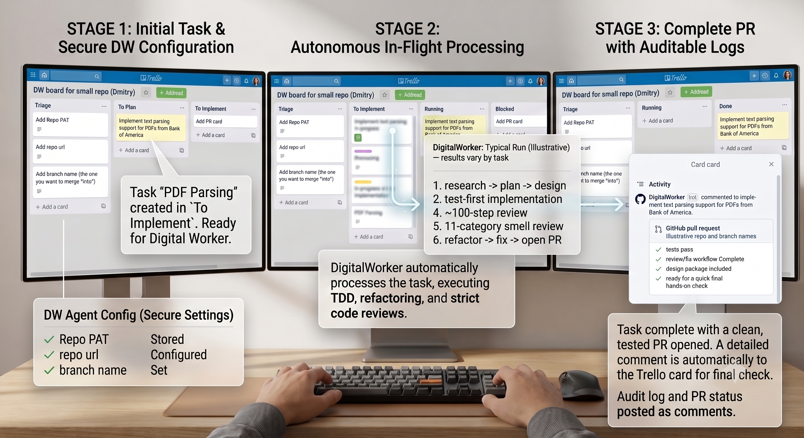

# Why DigitalWorker?

**Fast read:** read the headings and **bold** text. **Written for: developers and engineering teams who already use Copilot or Claude Code — and are tired of babysitting them and cleaning up their slop.**

<a href="https://github.com/apps/digitalworker-reviewer/installations/new" target="_blank" data-cta="install_app" data-location="header"><strong>Install the Reviewer — ~1 min, free trial</strong></a>&nbsp;&nbsp;·&nbsp;&nbsp;<a href="https://github.com/grandua/Digital-Worker-Demo/issues" target="_blank" data-cta="view_example" data-location="header"><strong>See it work — no install</strong></a>

<table>
  <tr><th colspan="2">Gallery — click to enlarge</th></tr>
  <tr>
    <td></td>
    <td></td>
  </tr>
  <tr>
    <td><strong>Illustrative Typical Run</strong> Actual results vary by task GitHub Issues works the same way</td>
    <td><strong>Real Life Plan Example</strong> From a real prod repo</td>
  </tr>
</table>

---
*Saving the world from spaghetti code.*

**You make the decisions that matter.** DigitalWorker turns a ticket into a tested, reviewed, production-ready[^4] <abbr title="a proposed change, packaged for review">pull request</abbr> — **senior-engineered code that scales past 50K+ lines at week-1 speed, where Copilot and Claude Code collapse into slop.** **It's like assigning a top-10%[^2] developer to a well-scoped task — at AI cost.**

**No iterative prompting. No babysitting. No cleaning up after the AI.**[^agent]

**Two products:**
- **[DigitalWorker Reviewer](#get-digitalworker-reviewer) — review your existing pull requests.**
- **[DigitalWorker Agent](#try-digitalworker-agent) — delegate the whole task.**

## Imagine…

**Copilot and Claude Code** look great on a 200-line task — **even when you ask them for clean code and tests, they ignore half your rules and print slop at scale.** Try shipping **50K+ lines and 3,000+ tests to prod** with them without drowning in rewrites. **Now imagine an agent you can actually trust while you sleep:**

- **You get the ultimate competitive advantage: you're 4-6x more productive than developers using Copilot or Claude Code**, because AI does ~80% of your work: **53K lines shipped on a side project in under 6 months; ~3K unit tests generated in under 3 months.**
- **AI solves your most complex business problems — and grows your solution without complexity limits, without slowing down: the same pace at month 11 and 50K+ lines as in week 1.**
- You tell AI *what* to do — *not how* — and it actually follows your engineering rules through to the end. **No hand-holding through every step.**
- **You see where the AI is about to go wrong** before it writes a line — **and steer its design decisions upfront before confusion turns into wrong dependencies.**
- **You never open a debugger (2+ years without attaching one once)** — the code is so modular and well-tested that AI isolates and fixes 100% of bugs for you.
- **Writing code by hand becomes purely optional (~1 hand-written line a month)** — even if you love coding, telling AI what to change is faster than finding the file yourself.
- **Code and architecture so clean that even AI can understand and change them without breaking things.**
- **Test coverage so high that even AI can't break what was working before.**
- **You do the work of an architect and a product manager — never a babysitter.**
- **No bloated AI slop — beautiful, well-architected code, minimal duplication, above-80% test coverage.**
- **You create a ticket even for a complex feature — and get it back <abbr title="a ticket in, production-ready code out is known as a Software Factory">solved, tested, and reviewed</abbr>**, close enough to done that you ship to production in a day or two.

**It's not imagination anymore — it's reality.** DigitalWorker itself was built this way — [see the receipts](#2-verify-our-claims--no-account-or-setup-needed).

## You're Doing AI Coding Slow!
***Why raw AI agents hit a wall — and the assumptions behind DigitalWorker:***

- **Current AI generates average code and architecture — sloppy, disorganized, badly engineered** — because it was trained on median human code — and most human code, public or private, ignores <abbr title="a design discipline where each part of the code carries its data and the rules that act on it together">object-oriented design</abbr> discipline, layering, and automated test coverage
- Without **working** architectural guardrails, **AI prints technical debt at machine speed** — **even when you give Copilot or Claude Code explicit rules (`CLAUDE.md`, skills, TDD prompts), they drop instructions mid-task and drift back to slop**
- **Guiding AI to convert its spaghetti code and broken architecture takes a lot of hard manual labor, technical knowledge, and skill** — reviewing, fixing, re-prompting — not just more AI usage. This is the main reason AI agents improve shipping speed only marginally — **controlled research puts real-world gains at ~25% at best, not manifold[^3]**
- **Your AI reads every line now:** even if engineers no longer read code, the agent does — **clean, encapsulated code is what lets AI navigate, reuse, and extend without breaking things; slop confuses AI even faster than it confuses humans**

See all

- **If a software solution is built with AI by a human who never fights back the AI slop**, complexity limits are reached quickly: **within as little as one month the AI's pace of change plateaus and the defect count becomes unmanageable**
- **Even if a team** of humans **fights back using AI to review AI** code, gives AI code standards, some architecture and instructions on how to review code, **the slop still overwhelms at scale — review capacity becomes the bottleneck**, new features break existing ones, and the codebase converges to a plateau where only long-frozen features are dependable.[^1]
- **Current AI has severely impaired judgment** which manifests in **constant confusion** about the real world
- **Current AI absolutely cannot be trusted to make important decisions**
- **AI will not fix itself without competent help from human experts:** AI often knows what the best practices are but does not follow them anyway, even when you explicitly ask it to.  Current AI is nowhere close to AGI — AI that can do any job a person can — and no known architecture changes that anytime soon.
- **Cheap AI generation does not make code quality matter less — it makes it matter sooner:** AI struggles against spaghetti even harder than human maintainers do — context limits and compounding errors hit hardest on large, messy codebases. **Controlled research found experienced developers ~19% *slower* with AI tools on their own mature repositories[^3]**
- **Engineering discipline is not a tax on speed** — past a few thousand lines **it is the speed**: in a peer-reviewed study of 39 production codebases, low-quality code carried 15×(!) more defects and took approximately 2.2× as long to resolve issues[^5]
- **As generation cost falls**, the binding **constraint shifts to whether the code can be changed at all** — making scalable, maintainable software the decisive economic prize

[^1]: Evidence from OpenClaw (2026): maintainers had to halt feature work for 7 weeks and then integrate 16,000 PRs in one release, stating that human review, architecture and release processes had become the bottleneck; ~80% of AI-generated PRs get rejected; of what passes, more than half of subsequent commits are fixes for what was just merged; new releases routinely regress working functionality, forcing users to pin old versions; the project's own engineers publicly acknowledged AI "vibe slop" slips through because review capacity cannot scale with agent output. Asking AI to fight its own slop shifts the bottleneck from writing code to reviewing it rather than eliminating it.

[^3]: The strongest controlled evidence brackets the gain narrowly: three field RCTs across 4,867 developers at Microsoft, Accenture, and a Fortune 100 company found a 26% increase in completed tasks with an AI assistant (Cui et al., Management Science, 2025) — while a 2025 METR RCT found experienced open-source developers were actually ~19% *slower* with AI tools on their own mature repositories, even though they believed they had been ~20% faster. Our founder's own measured experience before adopting AI-checklist-driven workflows matched the ~25% figure.

## What we claim as possible
- Nevertheless, the problem above has a better solution and current AI can be asked to run checklists with hundreds of items and **produce much better structured code that is actually easy to follow, easy to change**, with pretty good <abbr title="the tests catch any defect introduced into the covered code">mutation test coverage</abbr>, and that scales almost linearly with complexity.
- The catch is that AI will not follow such huge checklists if they are given to it as pure text and in a generic fashion. However, **checklists coupled with a smart, adjustable Instruction Engine can make AI follow every instruction**.
- **That is how impaired AI judgment still solves complex problems:** DigitalWorker forces AI to surface its product and class-design decisions upfront in a <abbr title="practice-run">dry-run</abbr> before writing a line of code — **so you override bad or lackluster decisions in minutes, and the Instruction Engine enforces the rest.**

## You make the decisions that matter. Build software you're proud to put your name on.

**Substantially fewer defects. Far less cleanup. More uninterrupted attention for the product you want to build.**

Your engineering competence sets the standard. DigitalWorker carries it through the work: turning a ticket into a tested, reviewed, production-ready[^4] pull request. **You shape the pivotal decisions and perform the final behavior check; DigitalWorker handles implementation, testing, review, and fixes.**

**Take pride in maintainable and beautiful work:** clear intent, <abbr title="cohesive objects">well-organized parts</abbr>, and code you can confidently extend.

**See the task and the resulting pull request:** compare the <a href="https://trello.com/b/6a03d01d53cf7bb95f8325dd/digital-worker-demo" target="_blank" data-cta="view_example" data-location="hero"><strong>source task cards</strong></a> with the <a href="https://github.com/grandua/Digital-Worker-Demo/pulls?q=is%3Apr+is%3Aclosed" target="_blank" data-cta="view_example" data-location="hero"><strong>generated code and pull-request/fix history</strong></a>. Two demo applications, generated from task cards, with <abbr title="light human review for a few selected parts">spot-reviews</abbr> and external defect feedback disclosed.

| Task → delivered result | Evidence |
|---|---|
| **Scientific Calculator** — generated from Trello task cards | **1,040 LOC + 1,613 LOC of tests (230 domain unit tests)** · Rich Domain Model · external-review defects fixed autonomously via a fix card |
| **URL Shortener API** — generated from task cards | **209 LOC + 187 LOC of tests (40 unit tests)** · Clean Architecture · Entity Framework data access · requirements traceability |

**Human involvement on both: fast spot-reviews only.**

[**Verify our claims — no account or setup needed**](#2-verify-our-claims--no-account-or-setup-needed)

<a href="https://agiledigitalworker.com/Engineering-Deep-Dive" target="_blank" data-cta="view_example" data-location="hero"><strong>See the engineering behind the result</strong></a> — the method, concrete code examples, comparison criteria, and economics. No signup required.

*Developers: jump straight to the [recorded evidence](#2-verify-our-claims--no-account-or-setup-needed) or the <a href="https://agiledigitalworker.com/Engineering-Deep-Dive" target="_blank">engineering deep dive</a>. For the engineering details, open the technical blocks below.*

---

### Two products. One engineering standard.

1. **DigitalWorker Reviewer — Keep your coding tools. Catch the AI slop before merge.**

   You asked for TDD, OOP and proper testable layers. Your AI drifted to bloated, disorganized slop anyway. DigitalWorker Reviewer detects Agile architecture violations such as incorrect layer dependencies and Anemic Domain Model anti-pattern, testability issues, test coverage gaps, and most code smells including code and class duplication. **The Reviewer comments; it does not change your code.** No Trello required.

   <a href="https://github.com/apps/digitalworker-reviewer/installations/new" target="_blank" data-cta="install_app" data-location="mid_page"><strong>Install the Reviewer — ~1 minute, free trial.</strong></a> Then comment `@digitalworker review` on any existing PR — first result in minutes.
2. **DigitalWorker Agent — Hand off the task. Get code implemented, reviewed, and refactored against the same architecture and maintainability standards.**

   <a href="#4-start-using-it-on-your-repo--github-issues" data-cta="install_app" data-location="mid_page"><strong>Install the Agent on your repo — ~2 minutes, private, &#36;15 credit included, no card required.</strong></a> Or watch it work first: the Agent is already installed on the <a href="https://github.com/grandua/Digital-Worker-Demo/issues" target="_blank" data-cta="view_example" data-location="mid_page">public demo repo</a> — open an issue mentioning `@digitalworker`, no permissions needed on your repos.

**The Reviewer uses the same review engine the full Agent uses on its own work. Use either product on its own.**

### Why it's different

- **A combination found nowhere else that we know of** — the AI follows a rigorous engineering process precisely instead of improvising, and applies the discipline a senior engineer would.
  

Show details

  **A combination found nowhere else that we know of:** it makes the AI follow a rigorous engineering process precisely instead of improvising, and it applies the discipline a senior engineer would — design decisions before code, <abbr title="unit tests">checks</abbr> before implementation, a rigorous review of every change, and no duplicate structures. Other agents can code, test, review, and submit changes for approval; **DigitalWorker carries the complete engineering method through delivery.** <a href="https://agiledigitalworker.com/Engineering-Deep-Dive#why-this-combination-matters" target="_blank" data-cta="view_example" data-location="mid_page">Inspect the difference</a>.

  

The technical version

  **You asked for TDD and OOP. Your AI drifted anyway.** DigitalWorker makes those disciplines part of delivery: test-first implementation, architecture review, refactoring, and fixes, carried by its proprietary instruction engine. A ticket becomes a tested, reviewed PR for your final behavior check. **You keep the decisions that matter. Try one real task—&#36;15 credit included.**

  **A combination found nowhere else that we know of:** high-precision instruction enforcement plus this depth of Agile, OOP, test-first TDD, review, and anti-duplication class design. Other agents can code, test, review, and open PRs; **DigitalWorker carries the complete engineering method through delivery.** <a href="https://agiledigitalworker.com/Engineering-Deep-Dive#why-this-combination-matters" target="_blank" data-cta="view_example" data-location="mid_page">Inspect the difference</a>.

  

  

- **Get relief from repeated review and repair** — fewer defects, far less cleanup, and a light human check instead of line-by-line review.
  

Show details

  Fast generation helps only when the result moves your product forward. DigitalWorker makes quality work part of delivery: it writes the <abbr title="unit tests">checks</abbr> before the code, reviews its own work against a ~100-item engineering checklist, then cleans up and fixes before handing you the change. **You receive the code, the tests, and the reasoning behind the decisions together.**

  The sequence is explicit: **a <abbr title="unit tests">check</abbr> of the intended behavior that fails first → the smallest change to pass it → review, cleanup, fixes, and re-checks**. <a href="https://agiledigitalworker.com/Engineering-Deep-Dive#from-a-requirement-to-a-checked-implementation" target="_blank">See how the method earns the outcome</a>.

  **Stop paying the AI bug tax.** **We observe substantially fewer defects and far less cleanup than AI coding without this enforced process.** **In founder production use, hands-on oversight is dramatically lower:** make a fast human check of decisions and trade-offs, inspect the key code that implements your business rules, then check the final behavior. **Routine code does not need line-by-line review in that operating experience.**

  

The technical version

  Fast generation helps only when the result moves your product forward. DigitalWorker makes quality work part of delivery: enforced test-first TDD, a dedicated ~100-step checklist-driven review (correctness, architecture and standards, code-smell detection, requirements audit), refactoring, and fixes before the PR. **You receive the code, tests, and design decisions together.**

  The sequence is explicit: **a failing behavior test → the minimum implementation to pass → review, refactoring, fixes, and re-checks.** <a href="https://agiledigitalworker.com/Engineering-Deep-Dive#from-a-requirement-to-a-checked-implementation" target="_blank">See how the workflow earns the outcome</a>.

  **Stop paying the AI bug tax.** **We observe substantially fewer defects and far less cleanup than AI coding without this enforced pipeline.** **In founder production use, hands-on oversight is dramatically lower:** spot-review the decisions and key domain code, then check the final behavior. **Routine code does not need line-by-line review in that operating experience.**

  **“Production-ready” means the implementation has completed the engineering workflow and is ready for your final hands-on check.** **Founder-observed results are not an independent benchmark or a defect-free guarantee for every repository.**

  

  

- **Keep control of consequential decisions** — your judgment decides the plan, assumptions, and pivotal design; the implementation review is carried for you.
  

Show details

  **You choose what to build, what "done" means, and the trade-offs you can live with.** You no longer review for defects — DigitalWorker's own reviews and checklists handle that; your review is judgment, placed early, before implementation. **Review the proposed plan, assumptions, and pivotal design decisions.** Before new parts of the code are created, inspect their proposed responsibilities and how they relate; correct the design where needed. DigitalWorker executes the engineering work through its proprietary Instruction Engine.

  For non-developers, the starting point is the plan and a plain description of what "done" looks like. You can delegate implementation and routine design; **novel or complex design still benefits from an experienced developer's judgment.** **You keep the final check that the software behaves as intended before the change is combined with your existing code.**

  

The technical version

  **You choose what to build, the acceptance criteria, and the trade-offs you can live with.** You no longer review for defects — AI reviews and checklists handle that; your review is judgment, placed early, before implementation. **Review the proposed plan, assumptions, and pivotal architecture decisions.** Before new classes are scaffolded, inspect their proposed responsibilities and relationships; correct the design where needed. DigitalWorker executes the engineering work through the proprietary Instruction Engine.

  For non-developers, the starting point is the plan and acceptance criteria. You can delegate implementation and routine design; **novel or complex architecture still benefits from an experienced developer's judgment.** **You keep the final behavior check before merge.**

  

  

- **Build something beautiful that stays maintainable** — clear intent, focused parts, and business rules kept separate from the technical details.
  

Show details

  **Beautiful software makes its intent easy to understand.** DigitalWorker looks for concepts your code already has before inventing new ones, keeps each part focused on one clear job, and keeps rules and the data they act on together. It separates your business rules from the technical details — **so the logic stays easy to read, test, reuse, and change** — and prunes needless complexity and duplicate structures.

  In the Calculator demo, one part of the code holds the calculator's current state and handles button presses through one clearly named action. The code that interprets mathematical expressions stays inside the part that needs it. The tests check the edges — numbers too large for the calculator to handle, and what happens after an error locks it. These are concrete examples of the clarity and care you can inspect. <a href="https://agiledigitalworker.com/Engineering-Deep-Dive#what-beautiful-maintainable-code-looks-like" target="_blank" data-cta="view_example" data-location="mid_page">Explore the code and edge-case tests</a>.

  This always-on engineering discipline **prevents almost all <abbr title="shortcuts that create future repair work">technical debt</abbr> in founder-observed production use.** Its method reflects more than 20 years of disciplined software development and two years of refinement with AI coding agents. The payoff extends beyond the next change: a codebase you can take pride in as features, integrations, customers, and business rules multiply and grow.

  **On well-scoped tasks, we expect DigitalWorker to match or exceed the output of the top 10%[^2] of professional developers**

  

The technical version

  **Beautiful software makes its intent easy to understand.** DigitalWorker searches for existing domain concepts before adding classes, checks cohesion, and brings behavior and state together in Rich Domain Models. It applies Clean Architecture — business rules separated from frameworks, UI, and databases for easy testing and reuse — KISS, DRY, and YAGNI, pruning unnecessary abstractions and duplicate structures.

  In the Calculator demo, `Calculator` owns its state and behavior through `Press(InputKey)`; the parser stays inside `MathExpression`. Tests exercise overflow boundaries and the behavior of a locked error state. These are concrete examples of the clarity and care you can inspect. <a href="https://agiledigitalworker.com/Engineering-Deep-Dive#what-beautiful-maintainable-code-looks-like" target="_blank" data-cta="view_example" data-location="mid_page">Explore the code and edge-case tests</a>.

  This autonomous engineering governance layer **prevents almost all technical debt in founder-observed production use.** Its method reflects more than 20 years of Agile and OOP practice and two years of refinement with AI coding agents. The payoff extends beyond the next PR: a codebase you can take pride in as features, integrations, customers, and business rules multiply and grow.

  **On well-scoped tasks, we expect DigitalWorker to match or exceed the output of the top 10%[^2] of professional developers**

  

  

- **Put your expertise into more ambitious work** — top-10% professional-developer output[^2] at AI execution cost.
  

Show details

  **Top 10% professional-developer output[^2] at AI execution cost.**

  Direct your judgment toward the product while DigitalWorker handles routine implementation and quality work. **The current usage model is model cost plus around 20% markup;** <a href="https://agiledigitalworker.com/Engineering-Deep-Dive#economics-pay-for-execution-keep-your-judgment" target="_blank">see the economics and how to evaluate total effort</a>.

  Enforced discipline is not overhead—it is why velocity does not slow down as the codebase grows. **In founder production use, a greenfield system with 4,000 automated tests and 53,000 lines of code reached production in 5 months.** **A parallel 51,000-line commercial codebase sustained ~85 commits per month for nearly a year without throughput degradation.**

  Experienced developers can take on more design work, product decisions, and quality leadership while retaining the parts of engineering they enjoy. **Non-developers can turn clear requirements into working software and bring in experienced judgment for consequential design choices.** The opportunity is to build more of what matters to you, with competence visible in the result.

  

- **Instruction-following is the hard problem, especially when going against training data.** But our breakthrough: **the Instruction Engine — virtually solved it for its engineering process in founder-observed production use.**
  

Show details

  AI learns from existing code — including its bad habits. In our production work, models repeatedly drift back to bloated spaghetti code and copy-pasted duplicates even when explicitly told not to. **A well-written instruction does not ensure it will survive a long task.**

  <abbr title="reusable packages of instructions, examples, and tools">Agent skills</abbr> help. Yet even top-tier models struggle with long sequences of instructions: losing track partway through, dropping requirements, piling mistakes on earlier mistakes, or claiming actions they never took. These failure modes are documented industry-wide — <a href="https://www.arxiv.org/pdf/2603.24755" target="_blank">research on iterative coding tasks</a> shows agents erode code quality over long tasks, and agents have been observed <a href="https://github.com/anthropics/claude-code/issues/39851" target="_blank">bypassing mandatory process requirements even under explicit "never skip" guardrails</a>. **Keeping the entire procedure on track is a substantial engineering problem.**

  **But DigitalWorker has virtually solved instruction-following for its engineering process in founder-observed production use.** Its proprietary model-adaptable <abbr title="makes the AI follow your process precisely instead of improvising or skipping instructions">Instruction Engine</abbr> keeps every required instruction in force through the whole task — design, implementation, testing, review, and repair — with two years of refined engineering rules behind them.

  That is the capability to evaluate when comparing it with <abbr title="a custom script or a collection of reusable instructions">agent skills</abbr>: sustained execution of the whole method. Inspect the delivered work and its fix history, then judge it on a bounded task of your own. **“Virtually solved” describes practical reliability in our engineering process; it does not promise that every model action is infallible.**

  

The technical version

  AI learns from code that includes anti-patterns. In our production work, models repeatedly gravitate back to procedural designs, duplicated classes, and anemic domain models — objects that hold data but contain no behavior, violating object-oriented design — even when explicitly instructed otherwise. **A well-written instruction does not ensure it will survive the whole execution chain.**

  Agentic skills help by packaging instructions, examples, and tools. Yet even top-tier models struggle with long, multi-step instructions: losing context, dropping requirements, compounding earlier mistakes, or hallucinating tool calls. These failure modes are documented industry-wide — <a href="https://www.arxiv.org/pdf/2603.24755" target="_blank">research on iterative coding tasks</a> shows agents erode code quality over long horizons, and agents have been observed <a href="https://github.com/anthropics/claude-code/issues/39851" target="_blank">bypassing mandatory workflow steps even under explicit "never skip" guardrails</a>. **Keeping the entire procedure on track is a substantial engineering problem.**

  **DigitalWorker has virtually solved instruction-following for its engineering workflows in founder-observed production use.** Its proprietary model-adaptable Instruction Engine keeps the design, implementation, testing, review, and repair instructions in the execution path, with two years of refined engineering rules behind them.

  That is the capability to evaluate when comparing it with <abbr title="a custom script or a collection of reusable instructions">agent skills</abbr>: sustained execution of the whole method. Inspect the delivered work and its fix history, then judge it on a bounded task of your own. **“Virtually solved” describes practical reliability in our production use; it does not promise that every model action is infallible.**

  

  

- **Bring your own expertise beyond code** — the same engine can carry your professional instructions, of any length.
  

Show details

  **The same engine can carry *your* professional instructions — of any length — and make AI execute them almost as if they were code.** Write your process in a <abbr title="a plain-text file with light formatting">Markdown</abbr> file and send it to us; we configure it for you for free.

  

The full pitch

  The Instruction Engine's purpose extends to your own professional methods. Developers, lawyers, marketers, and other professionals can bring their instructions in a Markdown file so the whole procedure is carried through. **Your competence defines the method; the engine supports its consistent execution.**

  Have a process with several stages that your AI keeps only partly following? Write your instructions in a Markdown file and <a href="mailto:info@agiledigitalworker.com" data-cta="email_founder" data-location="mid_page"><strong>send them to us</strong></a>. **We will configure it for you for free.** The built-in instructions are replaceable presets, not fixed: DigitalWorker currently ships software design and development related instructions, but swapping in custom instructions — for your own engineering method or for any other industry and profession — is trivial.

  **Your instructions stay yours.** They run through the same protected engine that guards our own proprietary instructions, and our AI provider stores nothing from our runs, so **the instructions are never retained for model training.**

  

  

The technical version

  The Instruction Engine's purpose extends to your own professional methods. Developers, lawyers, marketers, and other professionals can bring their instructions in `.md` format so the whole procedure is carried through. **Your competence defines the method; the engine supports its consistent execution.**

  Have a multi-step process that your AI keeps only partly following? Write your instructions in a Markdown file and <a href="mailto:info@agiledigitalworker.com" data-cta="email_founder" data-location="mid_page"><strong>send them to us</strong></a>. **We will configure it for you for free.** The built-in instructions are replaceable presets, not fixed: DigitalWorker currently ships software design and development related instructions, but swapping in custom instructions — for your own engineering method or for any other industry and profession — is trivial.

  **Your instructions stay yours.** They run through the same protected engine that guards our own instruction IP, and **provider-side Zero Data Retention means they are never retained for model training.**

  

  

- **Fits the way you want to work** — No repeated prompting and local setup; tasks run in parallel, decisions ship with the deliverable, managed AI infrastructure, replaceable discipline.
  

Show details

  **No repeated prompting, tasks are parallel while you focus elsewhere, decisions shipped with the code, managed AI infrastructure, a discipline preset you can replace with your own, and no local setup to start.**

  

Six ways it fits

  - **No repeated prompting:** Submit a ticket and let DigitalWorker run. Review pivotal decisions when needed, without continuously driving implementation through chat.
  - **Work can continue while you focus elsewhere:** Several tasks can run at once, each in isolation, or arrive on recurring schedules through Trello's Task Repeater (Trello boards only).
  - **Decisions accompany the deliverable:** The design package records the decisions made, the trade-offs weighed, and the assumptions — so the reasoning arrives with the code.
  - **Managed AI infrastructure:** Each phase — planning, implementation, testing, review — runs on whichever AI model currently gives the best quality for its price, and the choice adapts as prices and capabilities change. The depth of the process matches the task: a small, well-defined fix avoids the cost of extensive planning. We provide access to the AI models and the credentials they require.
  - **Opinionated but replaceable:** The built-in engineering discipline is a preset, not a cage. Bring your own process — the same Instruction Engine carries your instructions with the same precision.
  - **No local setup to start using it:** Connect your GitHub repository — tasks arrive as GitHub Issues, or as cards on an optional Trello board; neither is needed when using DigitalWorker purely as a reviewer of your GitHub changes. No software to install or command line to configure.

  

  

The technical version

  - **No iterative prompting:** Submit a ticket and let the workflow execute. Review pivotal decisions when needed, without continuously driving implementation through chat.
  - **Work can continue while you focus elsewhere:** Tasks can run simultaneously in isolated branches and environments, or arrive on recurring schedules through Trello's Task Repeater (Trello boards only).
  - **Decisions accompany the deliverable:** The design package records architecture decisions, trade-offs, class responsibilities, and assumptions.
  - **Managed AI infrastructure:** Each phase — planning, implementation, testing, review — runs on whichever model currently sits on the price/performance frontier for that kind of work, and the selection adapts as the frontier shifts. Process depth scales with the task too: a bounded fix doesn't pay for a heavy planning pass. We provide the model access and API keys.
  - **Opinionated but replaceable:** The Agile, Clean Architecture, and OOP discipline bundle is a preset, not a cage. Bring your own engineering instructions — the same Instruction Engine carries them with the same precision.
  - **No local setup to start using it:** Connect your GitHub repository — tasks arrive as GitHub Issues, or as cards on an optional Trello board; neither is needed when using DigitalWorker purely as the Reviewer GitHub App. No CLI configuration, IDE extension, or per-developer installation.

  

  

### Founder Experience

**I've used the AI engineering workflows behind DigitalWorker every day for two years.** With those workflows, **I've completed several production projects**, each with many thousands of unit tests and AI-run code review and testing. They took very minimal prompting, and I wrote only a few lines of code by hand. **All of them run smoothly in production today.**

In my own production work, **I delivered a greenfield system with approximately 53,000 lines of code and 4,000 automated tests to production in 5 months.** In parallel, **I sustained approximately 85 commits per month for nearly a year on a commercial codebase of approximately 51,000 lines, at constant effort, without throughput degradation.**

**The engineering results described here come from that daily production use.** See the process in action in the <a href="https://github.com/grandua/Digital-Worker-Demo" target="_blank">public demo repo</a>, including the tests, pull requests, and fix history.

### Getting Started

Choose your product below. **The Reviewer connects directly to GitHub; the Agent offers evidence, a public demo, and a private trial on your repo.**

(**You don't need to read the docs first** — wherever you meet DigitalWorker — on an issue, a card, or a pull request comment, **you can just ask it how something works**).

#### Get DigitalWorker Reviewer

DigitalWorker is the first reviewer we know of that enforces full and proper Agile discipline and architecture in code — including Patterns of Enterprise Application Architecture such as Layers and OOP/Rich Domain Model, testability, and clean code without code smells.

##### Watch it review your real <abbr title="PRs — proposed changes, packaged for review">pull requests</abbr> — GitHub only, ~1 minute

<a href="https://github.com/apps/digitalworker-reviewer/installations/new" target="_blank" data-cta="install_app" data-location="pricing"><strong>Install the DigitalWorker PR Reviewer GitHub App</strong></a> — every pull request gets an automatic read-only review by `digitalworker-reviewer[bot]` (architecture issues, code smells, inline comments); you can also post `@digitalworker review` on any PR. **Nothing to configure except installing the GitHub App itself — uninstalls in one click. Free trial included; usage beyond it is prepaid — nothing is ever charged automatically.**

Onboarding steps, org-wide install, and billing details: <a href="https://agiledigitalworker.com/user-guide" target="_blank">User Guide</a>.

#### Try DigitalWorker Agent

##### Start using it on your repo

###### GitHub Issues (Recommended for simpler onboarding)

<a href="https://github.com/apps/digitalworker-agent/installations/new" target="_blank" data-cta="install_app" data-location="pricing"><strong>Install the DigitalWorker Agent GitHub App</strong></a> on your repository, open an issue with your task and acceptance criteria, and mention `@digitalworker` — it delivers a tested, reviewed PR from its own worktree; **you decide what merges.** **The included &#36;15 credit covers a typical task — no card required; nothing is ever charged automatically.** **No Trello account, no local install, terminal, or per-developer setup required.**

Step-by-step onboarding, permissions, and trigger options: <a href="https://agiledigitalworker.com/user-guide" target="_blank">User Guide</a>. Not ready to grant repo access? Watch it work on the <a href="https://github.com/grandua/Digital-Worker-Demo/issues" target="_blank">public demo repo</a>.

**Or start even smaller:** comment `@digitalworker review` on an existing PR — findings land as comments; it has no write access and never touches your code.

###### Trello Board (Alternative)

Prefer a Kanban board? <a href="mailto:info@agiledigitalworker.com" data-cta="request_board" data-location="pricing"><strong>Email your preferred Trello board name</strong></a> — a private board is set up personally, usually same day. Requires a Trello account and a GitHub repository you can authorize. Steps: <a href="https://agiledigitalworker.com/user-guide" target="_blank">User Guide</a>.

##### Or watch it on our public demo repo — the Agent is already installed there

**Open an issue on the <a href="https://github.com/grandua/Digital-Worker-Demo/issues" target="_blank">public demo repository</a> with a bounded task, acceptance criteria, and `@digitalworker` in the description** — DigitalWorker delivers a tested PR right there in public. **Only a GitHub account needed: no Trello, no LLM key, no access to your repos.** Prefer Trello or email? <a href="https://agiledigitalworker.com/user-guide" target="_blank">Details in the User Guide</a>.

##### Verify our claims — no account or setup needed

Show how

Browse the <a href="https://github.com/grandua/Digital-Worker-Demo" target="_blank" data-cta="view_example" data-location="pricing">public source</a>, <a href="https://trello.com/b/6a03d01d53cf7bb95f8325dd/digital-worker-demo" target="_blank" data-cta="view_example" data-location="pricing"><strong>source task cards</strong></a>, and <a href="https://github.com/grandua/Digital-Worker-Demo/pulls?q=is%3Apr+is%3Aclosed" target="_blank" data-cta="view_example" data-location="pricing">PR history</a>. **Both applications were 100% generated by DigitalWorker from task cards on the Trello demo board** — the same flow runs from GitHub Issues on your repo. **Human involvement consisted of fast spot-reviews and, for the Calculator, passing external review feedback into a fix card for autonomous remediation.**

- **<a href="https://github.com/grandua/Digital-Worker-Demo/tree/main/Calculator" target="_blank">Scientific Calculator</a>: 230 domain unit tests**, a Rich Domain Model, and explicit edge-case behavior. **External review found issues, followed by autonomous remediation through a fix card.**
- **<a href="https://github.com/grandua/Digital-Worker-Demo/tree/main/UrlShortener" target="_blank">URL Shortener API</a>: 40 unit tests**, Clean Architecture, Entity Framework data access, and requirements traceability.

**Demo tasks are deliberately small so the whole ticket→PR→review→fix cycle is traceable in minutes — the same engine built DigitalWorker itself. Want real-scale proof? <a href="mailto:info@agiledigitalworker.com" data-cta="email_founder" data-location="pricing"><strong>Book a live walkthrough</strong></a> — we drive our private 50K+ line codebase on the video call.**

If you read the code like a senior dev, you'll find: methods are short, parameters few, state and behavior live in the same classes, Domain depends on nothing, and coverage is near-complete.

<a href="https://agiledigitalworker.com/Engineering-Deep-Dive#recorded-demo-results-and-recovery" target="_blank">Inspect the recorded coverage, execution times, human involvement, and recovery</a>. **Everything on this page is founder-observed in production use — not an independent benchmark; judge it against the repo. External review found Calculator issues our internal review missed — the autonomous fix history is part of the evidence.**

**Use your own judgment and your own AI coding agent.** The deep dive includes the <a href="https://agiledigitalworker.com/Engineering-Deep-Dive#evaluate-it-against-your-own-standard" target="_blank">balanced inspection prompt and evaluation method</a>, plus the commands to run the demo test suites yourself. **Choose your acceptance criteria first and judge the result, remaining cleanup, and hands-on time.** Your existing AI-agent costs may apply.

### Payment options

One payment link covers every purchase: <a href="https://buy.stripe.com/6oUaEPcAcaw2dbTbzk5J602" target="_blank">top up your balance</a>. Usage costs model cost plus 20%, prepaid — **nothing is ever charged automatically; work pauses at zero.** One prepaid pool serves both Reviewer and Agent under the same GitHub customer account. Full mechanics — business fields, personalized links, Trello balance: <a href="https://agiledigitalworker.com/user-guide" target="_blank">User Guide</a>.

### Quick answers

- **Does DigitalWorker modify my code directly?** No. The Reviewer is read-only — it has no write access. The Agent works in its own Git worktree and delivers every change as a pull request — **you decide what merges; uninstall in one click.**
- **What if it produces slop or misses the task?** You see the plan and pivotal decisions before implementation, and its ~100-item checklist review runs before the PR reaches you. The public demo even shows a real miss and the autonomous fix — [judge it there](#2-verify-our-claims--no-account-or-setup-needed).
- **What does it cost after the free trial or the &#36;15 credit?** Usage beyond that is prepaid at model cost plus 20%, with applicable tax separate. One payment link serves Reviewer and Agent at identical pricing — fill in the business-name field at checkout for a business purchase, leave it blank for personal; see [payment options](#payment-options) for balance top-ups. **Work pauses at zero, nothing is ever charged automatically.**
- **Do I need local setup, tokens, API key or Trello?** No — a GitHub App install and an issue are enough; Trello is optional.
- **What's the smallest way to try it?** Ask it to review a slice of your codebase (comment `@digitalworker review` on any PR) — findings arrive as PR comments; your code is never touched. Or run a task on the <a href="https://github.com/grandua/Digital-Worker-Demo/issues" target="_blank">public demo repo</a> — the Agent is already installed.
- **No GitHub account — can I still see it work?** Yes — [email us a public-safe task](mailto:info@agiledigitalworker.com) or [book a live walkthrough](mailto:info@agiledigitalworker.com) — we drive our private 50K+ line codebase on the video call.
- **What does DigitalWorker replace or augment?** Any AI coding agents and copilots at any autonomy level; code review tools — local, CI, AI-driven or not; and operational procedures or checklists where AI automation kept skipping instructions. **Not replaced:** light human oversight on large or prompt-heavy work, and deterministic quality tools — static analysis, linters, security checks, NDepend/SonarQube.
- **Engineers don't read code anymore — why does code quality still matter?** **Your AI is the reader now.** Clean, encapsulated code is what lets the agent navigate, reuse, and extend without breaking things — slop confuses AI even faster than it confuses humans.
- **AI cheats on my tests and instructions — how do you handle that?** We had to fix exactly that to make AI follow true OOP and test-first TDD — anti-gaming is built into our instruction sets and Instruction Engine.
- **Our process is custom — does this fit?** DigitalWorker isn't a prescribed process; the Instruction Engine carries your own checklists and engineering rules with the same precision.
- **What testing is covered?** Out of the box: test-first development, pre-merge evidence, and run-time verification in DigitalWorker Agent's own local environment for most stacks. Production or environment-specific verification is a scoped add-on — tell us what you need and we'll quote it.
- **Do you cover in-prod diagnostics and feedback loops?** Not out of the box — but the DigitalWorker Instruction Engine can carry your custom operational instructions out of the box, and Agile Design llc can be engaged for the most stubborn cases, when AI escapes or cheats instead of following your instructions.

---

**Ready when you are:** <a href="https://github.com/apps/digitalworker-reviewer/installations/new" target="_blank" data-cta="install_app" data-location="bottom_page"><strong>Install the Reviewer — ~1 min, free trial</strong></a> · <a href="#4-start-using-it-on-your-repo--github-issues" data-cta="install_app" data-location="bottom_page"><strong>Install the Agent — ~2 min, &#36;15 credit, no card</strong></a> · <a href="https://github.com/grandua/Digital-Worker-Demo/issues" target="_blank" data-cta="view_example" data-location="bottom_page"><strong>See it work — no install</strong></a>

---

*Internals, method, and economics: <a href="https://agiledigitalworker.com/Engineering-Deep-Dive" target="_blank">engineering deep dive</a>.* <!-- audience: dev, non-dev builder, business · ceiling: T1 narrative everywhere; T2/T3 in labeled technical compartments -->

[^2]: **Founder-observed expectation based on 20 years of development experience and production use — not an independently benchmarked ranking.**

[^4]: **“Production-ready” means the implementation has completed the engineering process and is ready for your final hands-on check.** **Founder-observed results are not an independent benchmark or a defect-free guarantee for every codebase.**

[^5]: Tornhill & Borg, *Code Red: The Business Impact of Code Quality* (IEEE/ACM TechDebt 2022) — peer-reviewed analysis of 39 proprietary production codebases (30,737 files): low-quality code contained 15× more defects, took 124% more development time to resolve issues, and showed 9× longer maximum cycle times. Independently, Stripe's Developer Coefficient survey (2018) found developers spend ~42% of the work week on technical debt and bad code. In founder experience AI-generated code falls under the same math: trained on average human code, it reproduces average professional quality at best, so the codebase-scale penalties apply unchanged.

[^agent]: **These benefits describe the full DigitalWorker Agent. The Reviewer reviews existing pull requests; it does not implement changes.**

---

**Agile Design llc · New York, NY**

<a href="https://www.linkedin.com/in/grand" target="_blank" data-cta="email_founder" data-location="pricing"><strong>Message on LinkedIn</strong></a> · <a href="mailto:info@agiledigitalworker.com" data-cta="email_founder" data-location="pricing"><strong>Email us</strong></a> · <a href="https://agiledigitalworker.com" target="_blank">agiledigitalworker.com</a> · <a href="https://agiledigitalworker.com/user-guide" target="_blank">User Guide</a>

Follow us: <a href="https://www.linkedin.com/company/2330043" target="_blank" data-cta="social_follow" data-location="footer">LinkedIn</a> · <a href="https://www.linkedin.com/groups/40979011/" target="_blank" data-cta="social_follow" data-location="footer">LinkedIn Group</a> · <a href="https://www.facebook.com/pages/Agile-Design-LLC/194844307249816" target="_blank" data-cta="social_follow" data-location="footer">Facebook</a> · <a href="https://twitter.com/AgileDesignLLC" target="_blank" data-cta="social_follow" data-location="footer">X/Twitter</a>

© 2026 Agile Design LLC. DigitalWorker and its workflow materials are proprietary.

<!-- Analytics: PostHog instrumentation — localStorage persistence (new vs returning), session replay with input masking, no cookies. Self-exclusion: visit /?no_track once per browser (sets localStorage dw_no_track). -->

