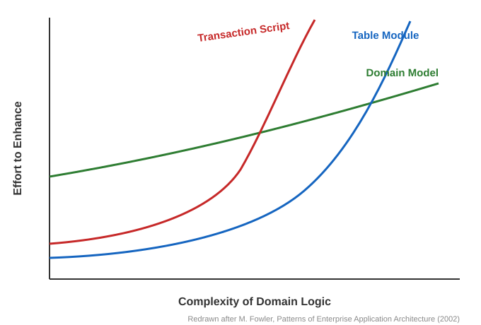

> *Written in response to [this r/webdev discussion](https://www.reddit.com/r/webdev/comments/1vnx44m/has_anyone_actually_maintained_a_vibe_coded/) ("Has anyone actually maintained a vibe coded code-base 12 months after launch? What did it look like?" — where the author also noted some "vibe coded projects held up well because the developer reviewed everything carefully and maintained discipline around the output"). I posted a condensed summary there; this is the expanded technical breakdown with architecture receipts, published research, and inspectable code.*

**Who this is for / TL;DR:** Vibe coders: Developers, tech leads, and founders maintaining an AI-built codebase past **~2K–10K lines of code**. Left unguided, LLMs default to duplicating whole classes in an everything-depends-on-everything style, causing complexity to compound exponentially until simple edits risk breaking unrelated features. But we found a fix that keeps shipping fast past **50K+ LOC**.

<!--more-->

## Five Symptoms at Month 12

In that `r/webdev` thread, the author described the same hangover turning up across year-old AI codebases:

1. Modifying an existing feature "gets uncomfortable," and you "cannot confidently change it without breaking something unexpected."
2. "Nobody can explain why a specific decision was made."
3. Dependencies "were added because the model suggested them, not because anyone evaluated them."
4. Generated tests "may not actually be testing the right things."
5. Projects "from 18 months ago" are "now quietly being rewritten" because maintenance outran the original build.

## 1. Why Changing One Feature Breaks Three Others

When you modify an existing vibe-coded feature, or add a new feature that is 90% identical to an existing one while keeping a slightly different parallel variation running, you hit the structural flaw built into how LLMs write code.

Integrating cleanly into existing abstractions is much harder than reimplementing from scratch, so an LLM takes the path of least resistance. Comparing two whole classes for overlapping responsibility is also too complex a task for its local context. Its default move for almost every change or ~90%-similar feature is to generate a new small **anemic data class (or record) paired with one or more procedural service classes**. To avoid naming collisions, it names those classes after the specific variation instead of real domain concepts (**typically 3-5-word use-case names**). Before long, **4-12 classes duplicate the same parts of each use case** in slightly different ways. **Neither deterministic tools nor LLMs typically catch that kind of duplication**, and by design those anemic-plus-procedural pairs have zero encapsulation.

In everyday feature work, most teams aren't focused on software architecture theory while tickets are shipping and tests are green. Standard framework and ORM tutorials treat data bags plus service classes as normal anyway, so it's easy to miss the slow drift into bloated, model-less code where everything depends on everything. Eventually, as a result, you can no longer trust class or method names and have to read practically every line just to change anything safely.

Ironically, even developers who write procedural handlers all day still enjoy consuming clean OOP APIs when someone else builds them (e.g. .NET's Base Class Library). You just never have time to pause mid-sprint to design one yourself or stop to refactor, and your coding agent won't do it for you either.

*Redrawn after Martin Fowler, Patterns of Enterprise Application Architecture (2002). Scattered procedures (**Transaction Script**, **Table Module**, **Anemic Domain Model**) spike exponentially; a **Domain Model** stays near-linear.*

This compounds exponentially with codebase size. **In our experience, somewhere past ~2K LOC**, changes start slowing down, and procedural model-less code becomes slower than investing in an object-oriented Rich Domain Model; **past ~10K LOC**, velocity crawls. It happens with any procedural codebase, just much faster with vibe coding because current AI struggles to hold a real domain model across files and duplicates classes far quicker.

Martin Fowler called the Anemic Domain Model ["a fundamental horror... contrary to the basic idea of object-oriented design"](https://martinfowler.com/bliki/AnemicDomainModel.html). Raw AI builds it at industrial speed: you ship fast in week one, then spend month twelve renting your own codebase back from the model one context window at a time.

### "Engineers Don't Read Code Anymore — Why Care?"

**Because your AI still has to read it.** Clean domain objects let an agent navigate and reuse code without guessing; **model-less spaghetti overflows its context window faster than it breaks a human reviewer**. Trusting vibe code because "humans don't read it anymore" is **like taking the battery out of a smoke alarm so you can sleep through the fire**.

Independent data backs up the same wall:

- **Mature-repo slowdown:** Controlled RCTs measure modest raw gains overall (**+26%** tasks, Cui et al., 2025), while experienced developers on their own mature repos were **~19% slower** with AI even when they *believed* they were ~20% faster (METR RCT, 2025).
- **Agent erosion:** *SlopCodeBench* ([`arXiv:2603.24755`](https://www.arxiv.org/pdf/2603.24755)) measured structural erosion worsening in **77%** of iterative agent runs (**2.0×** more eroded, **2.3×** more verbose than human repos).
- **Defect multiplier:** Low-quality code across 39 proprietary production systems carried **15× more defects** and took **+124% (`~2.2×`) longer** to fix (Tornhill & Borg, *Code Red*, 2022).
- **Why `CLAUDE.md` gets ignored:** [`anthropics/claude-code#39851`](https://github.com/anthropics/claude-code/issues/39851) shows agents skipping mandatory steps even under explicit `"NEVER skip"` rules. **Passive markdown rules are New Year's resolutions for LLMs**: read enthusiastically on January 1, ignored by sprint three.
- **Review drag:** **96%** of developers don't fully trust AI code correctness, and **38%** say reviewing it takes *more* effort than reviewing a human teammate's code (Sonar 2026 Survey, `n = 1,149`, [PDF](https://www.sonarsource.com/state-of-code-developer-survey-report.pdf)).

## 2. Our Findings: What Stops the Slide (and Why "Manual Discipline" Kills the Speedup)

Two things stop the slide if they are really enforced by working instructions rather than left as prompt advice:

- **Enforced encapsulation and structural deduplication.** **Keeping data and behavior together inside domain objects**, paired with an LLM-assisted **class-deduplication pass**, avoids reimplementing the same logic across 4-to-12 parallel classes. Running the same consistent architectural instructions across sessions also prevents style drift from file to file.
- **An upfront decision gate + test-first checks.** Separating consequential product and architecture decisions from routine implementation lets a human review and record the reasoning before code is written. **The same upfront decision gate catches unvetted third-party packages before the model pulls them in.** Coupled with test-first assertions and using multiple LLMs that are good at testing, this fixes roughly **80-90% of the "tests pass without testing the right things" problem in our own use**.

And what about the Reddit author's point that some "vibe coded projects held up well **because the developer reviewed everything carefully and maintained discipline** around the output"? By most (or all?) definitions, that is already not vibe coding anymore, and doing so takes **heavy manual effort**. It solves the 12-month maintenance problem, yet with all that manual review, reprompting, and hand-editing you end up roughly **+25% faster with AI at most**, instead of the **2x–10x** speedup people feel when vibe coding.

## 3. Keeping Week-1 Velocity (and Fun) Past 50K+ LOC

Moving that burden out of manual developer review into enforced, **working** automated guardrails **changed the math** for me. Across 50K+ LOC projects, I kept the same commit rate after 12 months as at the start, shipping around 10K LOC and ~1K unit tests per month with under 5% duplicated code. **Test coverage stays close to 100%** (automated via a coverage tool + fix loop in .NET, or a few review/fix passes in other languages). **From the outside, it still looks like vibe coding, yet adding features in *50K+ LOC* at month 12 is as fast and fun as week one**.

In our practice, five concrete gates keep those guardrails working across every task, paired with compiler, test-runner, code-quality, and coverage checks:

1. **Upfront design and human decision gate:** Search existing classes first, surface consequential architecture choices and any new packages for **human** approval/override, and sketch Class–Responsibility–Collaboration (CRC) boundaries before code exists.
2. **Rich Domain Model + deduplication:** Keep state and behavior together in real domain objects instead of procedural bags, followed by an LLM-assisted class-deduplication pass.
3. **Strict test-first TDD:** Write failing behavioral assertions first, verify the failure, then write minimal code to pass.
4. **~100-item checklist review that is actually enforced/working:** Check requirements traceability, architecture/layer boundaries, cohesion, KISS/DRY/SOLID, structural smells, and coverage gaps.
5. **Autonomous refactoring and fixes:** Resolve findings safely under the test net before opening a PR for final human check.

At [**Agile Design LLC**](https://agiledigitalworker.com/), we packaged these five gates into two GitHub Apps, [**DigitalWorker Agent**](https://agiledigitalworker.com/#get-digitalworker-agent) and [**DigitalWorker Reviewer**](https://github.com/apps/digitalworker-reviewer/installations/new), and we also take on **senior human-in-the-loop end-to-end delivery and AI-code rescue/cleanup engagements** built on the same process (focused on Agile architecture, extracting and encapsulating logic into a Rich Domain Model, and close to 100% automated test coverage).

* **Zero-install test:** Drop any public PR URL in an issue on [`grandua/dw-public-reviews`](https://github.com/grandua/dw-public-reviews/issues/) for a free architectural and code review, or run the Agent on a bounded task in [`grandua/Digital-Worker-Demo`](https://github.com/grandua/Digital-Worker-Demo/issues).
* **Install on your repo:** Try the read-only [DigitalWorker PR Reviewer](https://github.com/apps/digitalworker-reviewer/installations/new) (~1 min, free trial) or [DigitalWorker Agent](https://agiledigitalworker.com/#get-digitalworker-agent) (~2 min, free trial, no card).
* **Need rescue or delivery help?** Contact us at [info@agiledigitalworker.com](mailto:info@agiledigitalworker.com).

## 4. Production Velocity & Inspectable Receipts

Production numbers and small public demos are separate evidence sets:

- **Commercial production codebases (two separate systems):**
  - **Greenfield commercial app:** **~53,000 LOC** and **~4,000 automated tests** shipped to production in **5 months**.
  - **Ongoing commercial app:** **~51,000 LOC** sustaining **~85 commits/month** for nearly a year without complexity collapse.
  - **Token economics:** **>100K LOC** generated over 1 year on **three `$20/month` plans with zero overages**; `<5%` duplication keeps prompts small and test-first TDD cuts rework loops.
- **Inspectable public demos ([`grandua/Digital-Worker-Demo`](https://github.com/grandua/Digital-Worker-Demo)):**
  - **Scientific Calculator** (~2,000 lines across 46 files; **1,040 production LOC + 1,613 test LOC**, **230 domain unit tests**, **`99.6%` line / `95.4%` branch coverage** on domain logic, 4 lines and 15 branches uncovered): `Calculator` encapsulates buffer, memory, history, angle mode, and lockout behind `Press(InputKey)`, with `MathExpression` private inside (no manager or procedural service classes). When external PR review caught bugs missed by our first pass, a follow-up fix card resolved them autonomously.
  - **URL Shortener API** (**209 production LOC + 187 test LOC**, **40 unit tests**): Clean Architecture layers, Entity Framework persistence, and traceable requirements.

---

> © 2026 Sergey Getmanets / Agile Design LLC ([`agiledigitalworker.com`](https://agiledigitalworker.com/)).
>
> **License:** [Creative Commons Attribution 4.0 International (CC BY 4.0)](https://creativecommons.org/licenses/by/4.0/). You are free to share or adapt this article, provided you give clear attribution and keep an active link back to the [canonical post](https://agiledigitalworker.com/blog/2026/11/17/new-vibe-coding/).
