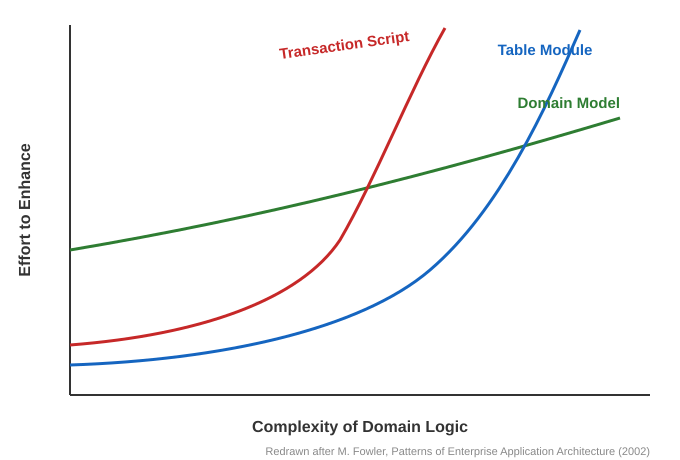

---
title: "Clean Code Almost Fixes Itself (And Today's AI Needs It More Than Humans Do)"
description: "Why waiting for smarter AI models will not fix buggy software, how clean building blocks give defects very few places to hide, and how to ship reliable AI-built software today."
excerpt_separator: <!--more-->
---

On Monday morning, you describe an app idea to an AI coding tool. By lunch, it runs on your screen. Buttons click, forms save, and you start wondering why companies ever paid engineering teams six figures to build software.

Three months later, you ask the same AI to add a simple coupon code to checkout.

The coupon works, except now customers cannot log in. You paste the error back into the chat. Login works again, except invoice totals are off by ten percent. By Friday afternoon, you are negotiating with a chatbot as if it held your business hostage, burning through usage credits just to get back to where you were on Tuesday.

Most people who hit this wall blame the model: *AI isn't smart enough yet. Give the labs another six months.*

We think the industry is chasing the wrong problem. **AI is already smart enough to build serious, dependable business software, as long as the code gives it a sane place to work.** Waiting for a smarter model to survive inside messy code is the slowest, most expensive way to get software that works.

**Who this is for:** Founders, CEOs, product managers, new vibe coders, and developers watching an AI-built app slow down and break after the first few weeks.

**The short version:** Almost all code behind business software isn't hard math or complex algorithms. Decades of [industry surveys](https://doi.org/10.1109/2.841783) and [lifecycle research](https://doi.org/10.1109/MS.2001.922739) point to a code organization problem instead: can one change happen without smashing three others? Break software into small, self-contained building blocks, and bugs lose every place to hide. AI labs spend billions making models better at digging through tangled code. Cleaner structure fixes that problem faster and cheaper, and today's models already work well inside it.

<!--more-->

## The billion-dollar detour

The biggest AI labs are racing to score a few extra points on automated coding tests. They pour billions into training data and computing power so the next model makes fewer mistakes on isolated programming puzzles.

Look at what those tests reward. Some grade a single function in isolation. Even the realistic ones, like SWE-bench, hand the AI one GitHub issue and check whether the tests pass. None of them check whether the codebase got easier or harder to change for next month's feature.

Trying to build reliable software that way is like spending billions training a Michelin-star chef to find cumin faster in a kitchen where every spice is dumped into one unlabeled bucket. A smarter chef will dig through the bucket a little faster. Or you could buy labeled spice jars.

Brute-forcing correctness inside messy code runs straight into diminishing returns. Every tiny gain in model accuracy costs a fortune in compute and money, yet defects still multiply the moment a real product grows past a weekend prototype.

The numbers from outside the labs tell the same story. In a 2025 [METR randomized trial](https://metr.org/blog/2025-07-10-early-2025-ai-experienced-os-dev-study/), 16 experienced developers worked on their own mature open-source projects, with and without early-2025 AI tools. With AI turned on, they finished tasks **19% slower**, while believing they had been 20% faster. Picture a team that feels faster every sprint while the release date keeps sliding.

Three more data points lean the same way:

- **Long inputs confuse models.** In July 2025, Chroma's lab study [*Context Rot*](https://research.trychroma.com/context-rot) tested 18 leading models and found accuracy dropping steadily as input grew longer and noisier, well before any model hit its memory limit.
- **Copy-paste is winning.** In June 2026, GitClear and GitKraken examined **623 million code changes** from 2023 to 2026 in [*The Maintainability Gap*](https://www.gitclear.com/the_ai_code_quality_maintainability_gap). Duplicated blocks of code jumped **81%**, while reorganizing and simplifying existing code fell **70%**. Copy-paste is now roughly five times more common than cleanup, pushing codebases into what GitClear calls "write-only mode."
- **Developers don't trust the output.** In Sonar's [2026 State of Code survey](https://www.sonarsource.com/state-of-code-developer-survey-report.pdf) of 1,149 developers, **96%** said they do not fully trust AI code, and **38%** said checking it takes more work than checking a human teammate's.

Smarter models shipped every few months through that entire window. Real-world maintenance still got worse.

## Most business software is a code organization problem, not rocket science

If you are a CEO, a product manager, or someone building your first app with AI, it is easy to assume bugs happen because programming is secretly hard math or complex algorithms. Code looks intimidating from the outside, so waiting for a genius model feels logical.

In everyday commercial software, hard math or complex algorithms are extremely rare.

Real-world studies back this up. When [*IEEE Computer* surveyed over 200 working software professionals](https://doi.org/10.1109/2.841783), not a single advanced math topic ranked in the 25 most useful skills on the job (calculus, linear algebra, and graph theory all landed in the bottom 25). Another [ACM study of 74 real apps](https://doi.org/10.1145/142750.142789) found nearly half the code (48%) is just screens and user interface. And a well-known [*IEEE Software* review](https://doi.org/10.1109/MS.2001.922739) showed why teams slow down over time: about **60%** of software spending happens after launch, mostly adding new features, where simply understanding the existing code is the hardest bottleneck.

Yes, a small slice of software truly needs hard math or complex algorithms: video compression, delivery-route planners, search engines, or the engines inside AI models. Most business apps don't. They are built out of ordinary business rules and routine steps. Check whether a customer qualifies for a discount. Calculate sales tax. Move an order from paid to shipped. Save a form and send a receipt.

A product manager can explain those rules on a whiteboard in three minutes. Sure, real rules pile up exceptions, and hooking into a payment provider or an old database has its own headaches. The rules can get messy. Hard math or complex algorithms are rarely the issue, and none of it requires superintelligence.

Computer scientist Fred Brooks split software difficulty into two buckets in [*No Silver Bullet*](https://doi.org/10.1109/MC.1987.1663532) (1987): the problem itself (*essential complexity*) and the mess we add while solving it (*accidental complexity*). Brooks argued the first bucket never shrinks. The second one is a choice, and tangled structure is how most teams keep refilling it.

A refund rule is simple. A refund rule smeared across fourteen files, sharing raw data with billing, email alerts, and user permissions, is miserable. The business rule never got complicated. The wiring did.

## Why clean structure leaves bugs nowhere to hide

We sometimes joke that well-structured code fixes itself.

Clean code doesn't literally wake up at 2 a.m. and repair its own typos. What happens in practice is simpler: **when software is split into small, self-contained building blocks, bugs have nowhere to hide.**

Compare a modern car to a homemade go-kart wired together in someone's garage. On the go-kart, one loose wire behind the steering column kills the headlights, the horn, and the ignition at once. On a modular car, the alternator is a sealed unit with one job and clean plugs. When the battery stops charging, troubleshooting points straight to the charging part, and swapping it will not disconnect the brakes.

Clean software works the same way. Instead of long step-by-step scripts where any line can reach in and change any piece of data, each part of the business lives inside its own small block. That block guards its own data and owns every rule allowed to change it.

*For your developer: this is encapsulation, real object-oriented design, and Domain-Driven Design, kept tidy through refactoring. Functional teams get the same effect with modules and pure functions. The principle is the boundary, not the keyword `class`.*

Remember the coupon that broke login? Here's why it happened:

- **Tangled script:** One giant `CheckoutScript` reaches directly into `UserLogin`, `TaxRate`, `EmailSender`, and `InvoiceTotal`. Touching a coupon rule can accidentally rewrite login or tax calculations.
- **Clean building blocks:** `Checkout` asks `Coupon` for a discount and tells `Invoice` to apply it. Neither block can reach inside the other, and neither one has permission to touch `UserLogin`.

Once a system is built out of those blocks, fixing problems shifts from detective work to quick elimination.

If an invoice total comes out wrong, only the `Invoice` block is allowed to touch invoice calculations. Neither a developer nor an AI has to comb through twenty unrelated files wondering who silently changed a number. Because the discount rule lives in one place instead of six copy-pasted scripts, a fix stays local instead of breaking checkout and reporting at the same time. Missing pieces stick out too, when every block has a plain business name and a clear boundary.

Clean blocks don't stop every bug. Two blocks that each work fine can still clash at the handoff, like a timing mix-up between billing and shipping. Even then, clean boundaries shrink a two-day hunt to a ten-minute check, because you inspect one seam instead of untangling twenty files of glue.

None of this is new. Teams forget it under deadline pressure. Raw AI forgets it on every task and at 100× the speed.

In 1972, David Parnas published [a classic paper on software modules](https://doi.org/10.1145/361598.361623), showing with a worked example that grouping code around separate jobs, each hiding its own details, makes software far easier to change than one long step-by-step flowchart. Thirty years later, Martin Fowler sketched the curve below: step-by-step scripts feel cheaper in week one, then climb steeply in cost as features grow, while self-contained blocks rise gently. Fowler also warned against the fake version (passive data buckets bossed around by giant outside scripts), which he named the *Anemic Domain Model*, and wrote about ["the fundamental horror"](https://martinfowler.com/bliki/AnemicDomainModel.html) of that pattern.

*Redrawn after Martin Fowler, Patterns of Enterprise Application Architecture (2002). Fowler drew it as a sketch of the trend, not measured data. Tangled step-by-step scripts get harder with every feature, while self-contained building blocks keep effort steady.*

This answers the biggest worry founders and vibe coders have: *"We have a deadline Friday. Won't clean structure slow us down?"* On a throwaway weekend prototype, yes, organizing blocks takes a bit more thought upfront. In our experience, though, the crossover hits far earlier than most people expect, around **2,000 lines of code**. Past that point, clean structure stops being extra overhead and becomes the only reason you are still shipping fast.

Modern measurements put hard numbers on that curve. In [*Code Red*](https://arxiv.org/abs/2203.04374) (2022), Adam Tornhill and Markus Borg measured 39 real company codebases covering 30,737 files. Messy code carried **15 times more defects**, took **more than twice as long (+124%)** to fix, and suffered **9 times longer** worst-case delays.

In January 2026, Borg, Tornhill, and colleagues tested whether AI suffers the same penalty. Across 5,000 programs and six AI models in [*Code for Machines, Not Just Humans*](https://arxiv.org/abs/2601.02200), messy code caused **at least 60% higher AI error rates**. Their [August 2026 follow-up](https://arxiv.org/abs/2608.18645) showed messy code also weakens AI-written tests and burns more tokens (meaning higher AI bills for worse results).

Structure matters more for AI than for a veteran developer, for one plain reason: AI has no memory of your codebase. A veteran remembers that tax logic also lives in the reports module. The AI starts every task like a new hire on day one. In a 20,000-line tangle, it copies a file it couldn't find and breaks a screen nobody asked it to touch. Give it one block with clear edges and tests, and it changes the coupon rule while every login test stays green.

## The catch: you cannot just ask your AI for clean code

If clean building blocks solve this much, why not just type *"Keep the code clean and modular"* into Copilot or Claude Code and move on?

Anyone who has tried for more than a week knows how that movie ends.

AI models learned from mountains of existing code, and most existing code is tangled, step-by-step glue. When you ask for a new feature that is 90% identical to an existing one, raw AI takes the path of least resistance. Fitting cleanly into existing blocks takes real judgment, so the model copy-pastes a brand-new set of nearly identical files instead.

Leaving written instruction files for the AI (e.g. CLAUDE.md) does not stop the slide either. Writing *"NEVER skip tests or duplicate logic"* in a `CLAUDE.md` file works about as well as taping a *"please wash your dishes"* sign over an office sink. Everyone respects it on Monday. By Thursday, the sink is full again.

Researchers have watched this happen at scale. In [*SlopCodeBench*](https://www.arxiv.org/pdf/2603.24755), code structure got worse in **77%** of multi-step AI coding sessions, leaving AI projects more than twice as bloated as human-written ones. Public bug reports even show top coding agents skipping mandatory steps written under explicit `"NEVER skip"` rules ([`anthropics/claude-code#39851`](https://github.com/anthropics/claude-code/issues/39851)).

You can fight that drift manually by reviewing every line, redesigning messy output, and re-prompting until the AI complies. Plenty of strong developers do. The problem is that babysitting the AI eats the speed advantage you wanted in the first place.

*Curious how much hidden tangling is already sitting in your current project? You can run a read-only check on any existing pull request (a proposed code change waiting for approval on GitHub) in about a minute with <a href="https://github.com/apps/digitalworker-reviewer/installations/new?utm_source=blog&amp;utm_campaign=clean-code-almost-fixes-itself" target="_blank" data-cta="install_reviewer" data-location="blog_mid"><strong>DigitalWorker Reviewer (free trial)</strong></a>.*

## Stop waiting for next year's model. Organize your code structure today.

Changing the structure upfront is the obvious win the industry keeps walking past. It is also why we built **DigitalWorker** at [Agile Design LLC](https://agiledigitalworker.com/?utm_source=blog&utm_campaign=clean-code-almost-fixes-itself) to put structure first.

Instead of hoping a future model can survive spaghetti code, DigitalWorker turns a plain task ticket into clean building blocks and passing tests before a single change touches your main code.

Before writing code, DigitalWorker posts its plan, proposed building blocks, and any new add-on libraries right on your ticket for your approval. You spend a few minutes steering the product and design choices that matter instead of discovering wrong assumptions three days later. Once you approve the direction, our proprietary Instruction Engine keeps required engineering rules in the execution path so the AI cannot quietly drop them mid-task.

No AI guarantees zero bugs, and you still run a brief final check before shipping. Even when an edge case gets past review, clean structure keeps repairs cheap: describe what went wrong in a short fix ticket, and the Agent pins it with a test and repairs the single block that owns it.

We run this process on real production software, not slide decks. We keep our private commercial numbers and small public demos separate:

- **Commercial system #1 (brand-new build):** Shipped to production with **~53,000 lines of code and ~4,000 automated tests in 5 months**.
- **Commercial system #2 (long-term pace):** A **~51,000-line** codebase sustained **~85 code updates (commits) a month for nearly a year** without slowing down or needing a rewrite.
- **Cost and duplication:** Across those systems, duplicated code stayed **under 5%**, and over **100,000 lines** were built in a year for **$60 a month** across three $20 AI subscriptions, with zero overage charges.
- **Inspectable public demo repo (<a href="https://github.com/grandua/Digital-Worker-Demo" target="_blank" data-cta="demo_repo" data-location="blog_proof"><code>grandua/Digital-Worker-Demo</code></a>):** You can read the original task cards, generated code, and fix history yourself. The Scientific Calculator demo (1,040 app lines, 1,613 test lines, 230 automated tests) reached **99.6% line coverage and 95.4% branch coverage** on its business logic (meaning nearly every code line and decision path was tested), all inside self-contained blocks with no procedural "manager" or "service" scripts. When outside reviewers spotted bugs our first pass missed, a single follow-up ticket fixed them autonomously.

## Quick questions

**Why does AI coding feel magical in week one and painfully slow by month three?**
In week one, the whole app fits inside the AI's short attention span. By month three, raw AI has copy-pasted overlapping scripts across dozens of files, so every new request breaks something hidden elsewhere.

**Can I solve this with better prompts or a stricter `CLAUDE.md` file?**
Static rule files do not help to enforce code encapsulation and Rich Domain Models at all. They help with some other aspects on small tasks, but models routinely drop written rules once sessions get long. Keeping code clean at scale means enforcing the design, testing, and review steps inside the execution path itself.

**Do I need to be a senior software architect to use DigitalWorker?**
No. You describe what the feature should do and review a plain plan before code is written. DigitalWorker handles the building blocks, tests, review, and fixes, though complex novel designs still benefit from an experienced developer's eyes.

## Test clean structure on your own code (in under two minutes)

You do not need to wait for artificial general intelligence to build software that stays fast past month three. You need code organized cleanly enough that neither your team nor your AI has to guess what breaks next, so the next coupon ships on Tuesday instead of turning into a Friday hostage negotiation.

**Before you install:** The Reviewer reads code and posts comments. It cannot push, merge, or edit anything. The Agent works on its own branch and opens a pull request, and nothing reaches your main code until someone on your team clicks merge. Our AI provider runs with zero data retention, so your code is never kept for model training. Both tools run on GitHub today. Using GitLab, Bitbucket, or no repo at all? See the done-for-you options below.

**Start here (~1 minute, read-only):** Install <a href="https://github.com/apps/digitalworker-reviewer/installations/new?utm_source=blog&amp;utm_campaign=clean-code-almost-fixes-itself" target="_blank" data-cta="install_reviewer" data-location="blog_bottom"><strong>DigitalWorker Reviewer</strong></a> (free trial, read-only: it comments on pull requests and never edits your code). Then post `@digitalworker review` on the last pull request that broke something unrelated, and see which tangles and missing tests it flags.

**Not the person who installs things?** Forward this article to your lead developer with a note like:

> Can you install DigitalWorker Reviewer on your repo? It's read-only, takes about a minute, and has a free trial. Then comment `@digitalworker review` on the last pull request that broke something unrelated. Let's see what it flags.

**Other ways in:**

- **Build clean from the start (~2 minutes):** Install <a href="https://agiledigitalworker.com/?utm_source=blog&amp;utm_campaign=clean-code-almost-fixes-itself#get-digitalworker-agent" target="_blank" data-cta="jump_to_agent_setup" data-location="blog_bottom"><strong>DigitalWorker Agent</strong></a> (free trial included, no credit card). Hand it one clear GitHub task, let it open an isolated pull request, and judge the code, tests, and remaining cleanup yourself.
- **Try it with zero install:** Paste any public pull request link into <a href="https://github.com/grandua/dw-public-reviews/issues/" target="_blank" data-cta="public_mirror_review" data-location="blog_bottom"><code>grandua/dw-public-reviews</code></a> for a sample architectural review (no install needed), or test the Agent live on <a href="https://github.com/grandua/Digital-Worker-Demo/issues" target="_blank" data-cta="demo_repo" data-location="blog_bottom"><code>grandua/Digital-Worker-Demo</code></a>.

Running a company and want an engineer to handle the whole build, or rescue a stalled AI codebase piece by piece, without touching GitHub yourself? Look at our <a href="https://agiledigitalworker.com/?utm_source=blog&amp;utm_campaign=clean-code-almost-fixes-itself#done-for-you-delivery" target="_blank" data-cta="view_services" data-location="blog_bottom">done-for-you delivery options</a> or email <a href="mailto:info@agiledigitalworker.com?subject=Done-for-you%20delivery" data-cta="email_services" data-location="blog_bottom">info@agiledigitalworker.com</a>.

*Developers who want the code-level version, with architecture details and side-by-side comparisons, can read our companion post: [New Vibe Coding: Ship Fast and Keep It Fun Beyond 10K Lines of Code](https://agiledigitalworker.com/blog/2026/11/17/new-vibe-coding/).*

---

> © 2026 Agile Design LLC ([`agiledigitalworker.com`](https://agiledigitalworker.com/)).
>
> **License:** [Creative Commons Attribution 4.0 International (CC BY 4.0)](https://creativecommons.org/licenses/by/4.0/). You are free to share or adapt this article, provided you give clear attribution and keep an active link back to the [canonical post](https://agiledigitalworker.com/blog/2026/11/26/clean-code-almost-fixes-itself/).
